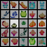
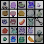
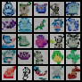
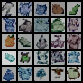
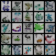
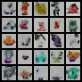
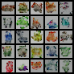
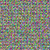
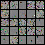

# Pixel-Art Sprite Generation with Diffusion Transformers

> My part of a 4-person final project for **Deep Learning** (NYCU, Spring 2025). The team built diffusion models that generate 16×16 pixel-art game sprites. I explored **Transformer-based denoising backbones** and compared five architectures, from a plain ViT to hybrid U-Net/ViT designs.
>
> Team repository: [wilbur1240/dl-final](https://github.com/wilbur1240/dl-final). The team covered a convolutional U-Net baseline, color-conditioned generation, and this Transformer track.

<p align="center">
  
  
  <br><em>Samples from my two strongest models: ViT with conv skip (left) and U-Net Transformer (right)</em>
</p>

## Task

- **Data**: 16×16 RGB pixel-art sprites from Kaggle, in 5 classes: *human, non-human, food, spell, side-face*
- **Goal**: generate new sprites that look like they belong to the dataset, conditioned on class where the model supports it
- **Question**: convolutional U-Nets are the standard diffusion backbone. How well do Transformer-based backbones work on very small, low-resolution images, and which inductive biases do they need?

## Diffusion framework (written from scratch)

| Component | Implementation |
|---|---|
| Noise schedule | Linear and **cosine** β-schedule (Nichol & Dhariwal), T = 1000 |
| Objective | ε-prediction MSE, plus an optional L1 reconstruction term on x₀ |
| Sampling | DDPM ancestral sampling and **DDIM** (100 steps, η = 0) |
| Conditioning | Class-label embedding (+1 "null" token), with **classifier-free guidance** sampling |
| Training | `accelerate` fp16 mixed precision, **EMA** weights (0.999), Adam 1e-4, batch 128 |

## Architectures compared

| # | Model | Idea | Size |
|:-:|---|---|---|
| 1 | **ViT backbone** | Plain Transformer encoder over conv patch tokens. The time embedding is added to every token. | emb 512, depth 6 |
| 2 | **ConvViT** | Same as #1, with a lighter convolutional patch embedding | emb 256, depth 4 |
| 3 | **ViT + conv skip** | 3×3 conv lifts RGB into the embedding space, then the ViT runs, then a 3×3 conv projects back, with a **global residual** to the input | emb 256 / 512 / 1024, depth 6–8 |
| 4 | **U-Net Transformer** | 4-level conv U-Net with **CBAM** attention. Every stage adds a Transformer block with **self-attention, plus cross-attention to the class embedding**. | base 64, emb 256, ~24M params |
| 5 | **U-ViT PixelArt** | Conv stem, then Transformer blocks at the 8×8 and 4×4 token scales, then a decoder with long skip connections (U-ViT style). Class embedding is added to the time embedding. | emb 256, 2+4+2+1 blocks |

## Results

The project was evaluated **qualitatively**, by visually inspecting 5×5 sample grids from the EMA model.

| ViT backbone (emb 512, d6) | ConvViT (emb 256, d4) | ViT + conv skip (emb 256, d6) | ViT + conv skip (emb 512, d6) |
|:-:|:-:|:-:|:-:|
|  |  |  |  |
| Clear silhouettes and varied colors, but edges are blurry and some sprites break apart | Recognizable shapes, but noisier and more washed-out than #1 | Pale, low-contrast sprites with scattered pixels | Shapes become more coherent, colors still muted |

| ViT + conv skip (emb 1024, d8, ~10 h) | U-Net Transformer | U-ViT PixelArt |
|:-:|:-:|:-:|
|  |  |  |
| **Best pure-Transformer result**: clean outlines, saturated colors, coherent objects (food, characters) | **Sharpest overall**: crisp outlines and recognizable objects. The conv inductive bias helps a lot at 16×16. | Rich colors and the most diversity, but fine details are messier |

### Observations

- **Pure ViTs need scale.** At emb 256 the conv-skip ViT produced faint, noisy sprites. At emb 1024 and depth 8 with ~10 h of training, it matched the hybrid models. Patch tokens carry little local structure at 16×16, so the model has to learn it with capacity and training time.
- **Convolutional inductive bias matters at low resolution.** The U-Net Transformer got sharp results at a much smaller width, because convolutions handle local pixel structure and attention handles global layout and class conditioning.
- **The global residual helps stability.** Adding the input back in the conv-skip ViT gave the Transformer an easier target than predicting the full output from scratch.

### Failure cases along the way

| Pure noise | Collapse to gray |
|:-:|:-:|
|  |  |
| Early debugging run: samples never left the noise distribution. | The model collapsed to a flat gray "average sprite" that minimizes MSE without learning the data. |

## Repository structure

```
notebooks/diffusion_transformer.ipynb   # data pipeline, diffusion, trainer, all model definitions
results/                                # sample grids for each architecture
results/debug/                          # failure cases
```

## How to run

1. Download the 16×16 sprite dataset (`sprites.npy`, `sprites_labels.npy`) and place it next to the notebook.
2. Install the dependencies: `torch torchvision accelerate ema-pytorch einops tqdm matplotlib`
3. In the **Network modules** section, run the cell for the model you want, then run **Usage** to train. Samples are written to `./results` every `save_interval` steps.

## My contribution

- Designed and implemented all five Transformer-based backbones above
- Built the diffusion training and sampling pipeline used for these experiments (cosine schedule, DDIM, CFG sampling, EMA trainer)
- Ran the architecture comparison and analyzed the failure cases
